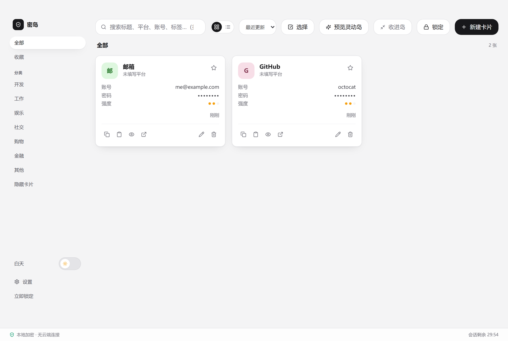
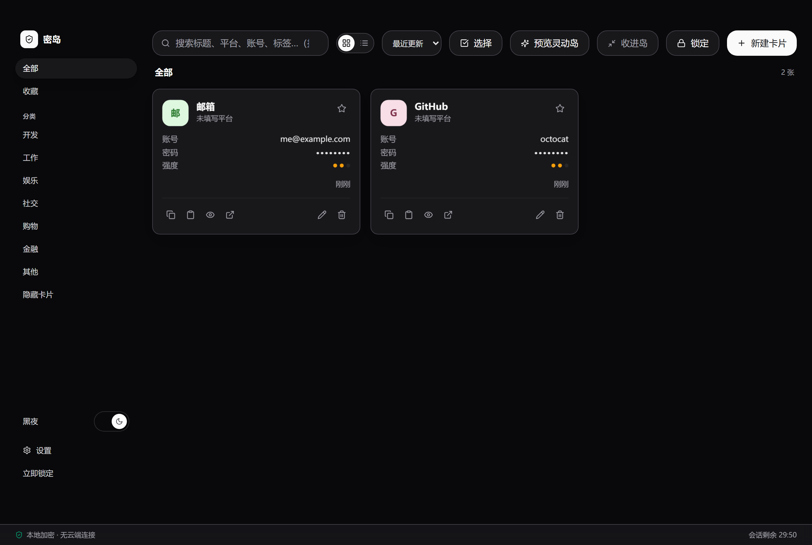

# 密岛 KeyIsland

本地优先的 Windows 桌面密码管理器。**数据只存在本机、加密落盘、不联网、不上传。**

Tauri 2 · React 18 · Vite 5 · Rust · Zustand · framer-motion

## 下载

到 [**Releases**](https://github.com/Fatcattie/keyisland/releases/latest) 拿最新版：

| 文件 | 说明 |
|---|---|
| `KeyIsland_<版本>_x64-setup.exe` | 安装包。装到 `%LOCALAPPDATA%\KeyIsland`，带开始菜单与卸载项 |
| `keyisland.exe` | 免安装单文件，双击即用（不写注册表） |

需要 Windows 10 / 11（x64）与 WebView2 运行时（Win10/11 一般已预装）。

> 安装包**没有做代码签名**，首次运行 Windows SmartScreen 会提示「未知发布者」——
> 点「更多信息」→「仍要运行」。想省掉这个提示只能去买签名证书。

## 界面

白天 / 黑夜两套主题，默认跟随系统：





## 它是什么

- **加密保险库**：主密码派生密钥，数据以 SQLCipher 落盘；另有一份恢复码，主密码忘了还能救。
- **灵动岛**：主面板关掉不是消失，而是缩成贴边的胶囊。鼠标推到屏幕上沿唤出，
  滚轮翻卡、Enter 复制密码、⇧Enter 复制账号、**中键退出选择**。
- **白天 / 黑夜主题**：侧栏底部一键切换；没手动选过时跟随系统的深色设置。
- **隐私遮罩**：标为「遮罩」的卡片，账号与密码默认打码，要二次验证才显示。
- **剪贴板自动清理**：复制后到点自动清空，且只清「仍是这次写入的内容」。
- **密码生成器与强度提示**、**安全体检**（重复 / 弱 / 过期）、**审计日志**、
  **导入导出 CSV / 备份**、**系统托盘**。

## 从源码跑

```bash
cd app
npm install
npm run dev            # 浏览器预览（内存存储，重启即清空，别放真实数据）
npm run typecheck      # tsc --noEmit
npm run test:run       # 单元测试（vitest + jsdom）
```

桌面端还需要 Rust 工具链 + MSVC + Windows SDK，环境变量与踩坑见
[`app/docs/DESKTOP-BUILD.md`](app/docs/DESKTOP-BUILD.md)。

```bash
cd app
npm run desktop:doctor   # 九项环境自检，缺什么直接给安装链接
npm run desktop:dev      # 开发模式启动桌面应用
npm run desktop:build    # 出 NSIS 安装包
npm run release:publish  # 出包 + 打 tag + 发 GitHub Release（见下）
```

## 发版

`git push` 只推源码——安装包在 `.gitignore` 里，不会进 git 历史。发版是独立的一步：

```bash
npm run release:publish -- --dry-run   # 预检 + 打印发布说明
npm run release:publish                # 出包 → 校验产物 → 打 tag → 建 Release
```

脚本会先卡住这些前提，任何一条不过就中止：三处版本号一致、工作区干净、HEAD 已推送、
tag 未被占用、gh 已登录、构建环境齐全、**exe 里的版本资源等于当前版本**（防复用旧产物）。

## 安全边界

- 主密码、恢复码、DEK、资产明文**不进入**日志、URL、`localStorage` / `sessionStorage`。
- 锁定时清空内存中的密钥与明文缓存，并撤掉剪贴板清理任务。
- 浏览器预览用内存存储，重启即清空，**禁止用于真实数据**。
- 没有遥测、没有联网请求（连"检查更新"都是默认关闭的显式开关，且当前未接入）。

## 文档

- [`app/README.md`](app/README.md) —— 工程结构、验证基线、灵动岛实现要点
- [`app/docs/DESKTOP-BUILD.md`](app/docs/DESKTOP-BUILD.md) —— 桌面构建与工具链
- [`app/docs/user-guide.md`](app/docs/user-guide.md) —— 终端用户手册
- [`app/docs/adr/`](app/docs/adr/) —— 架构决策记录
