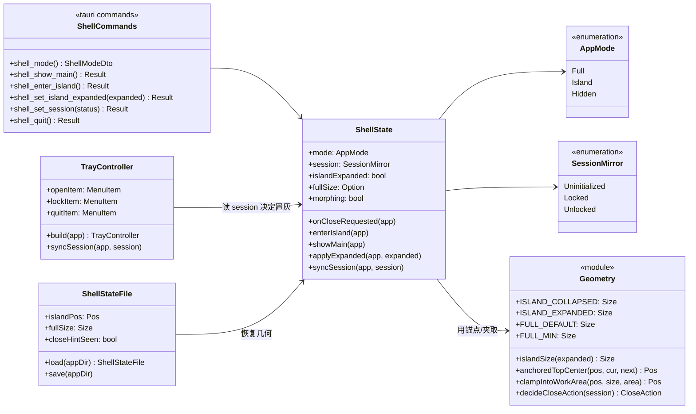
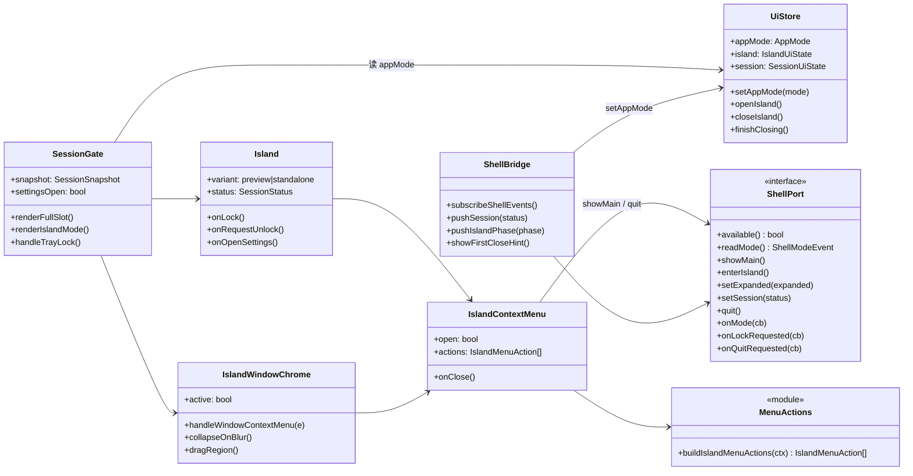
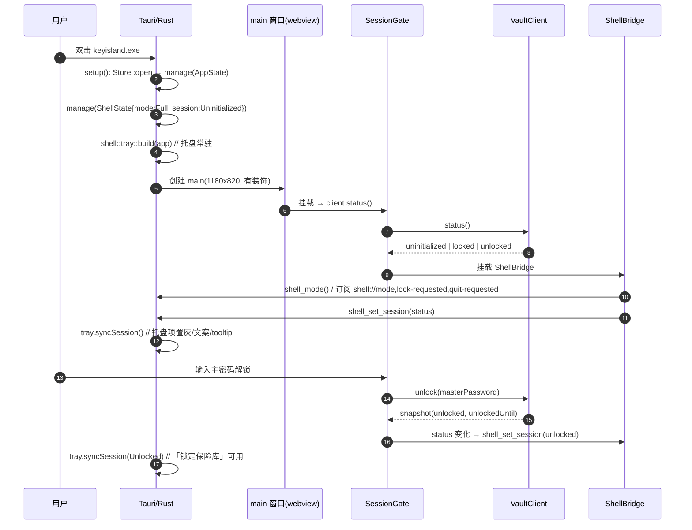
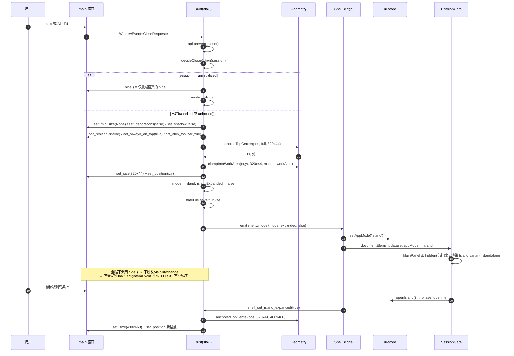
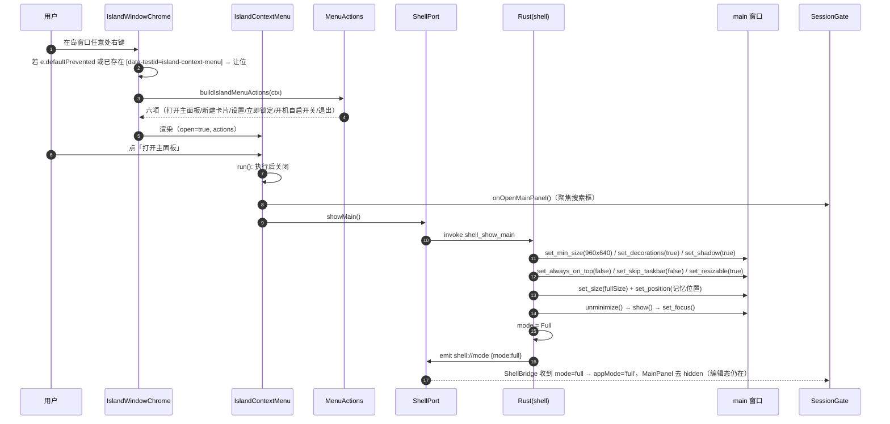
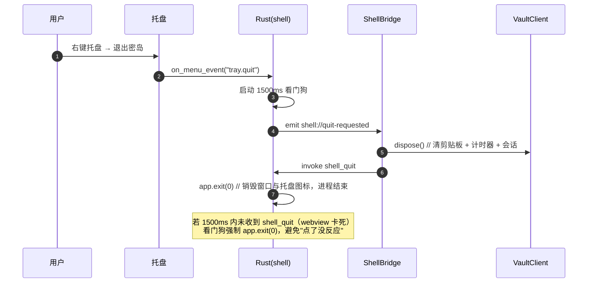
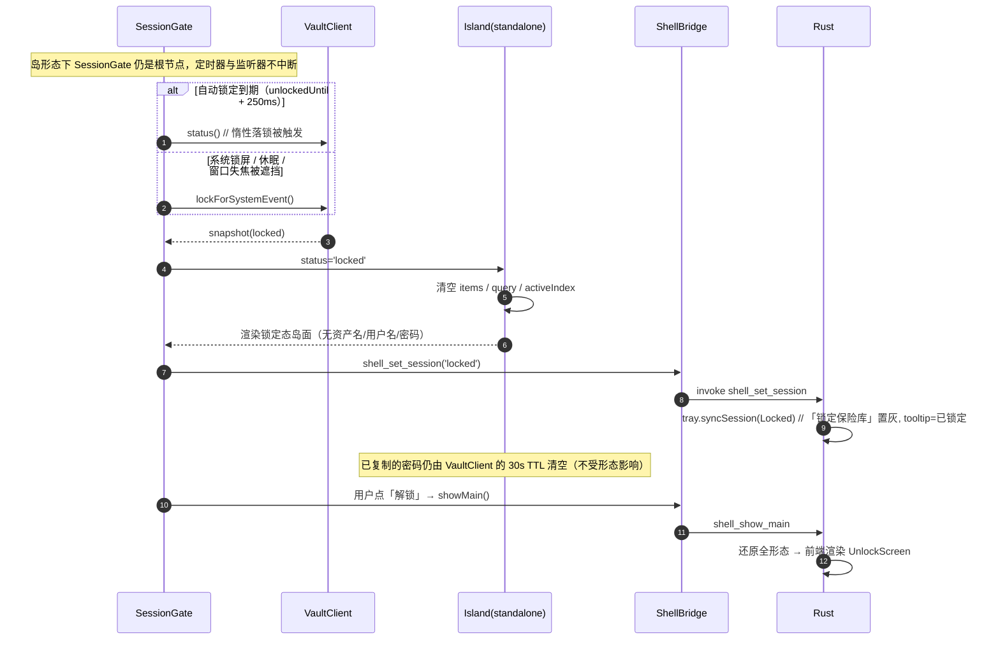
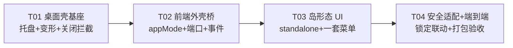

# 密岛 KeyIsland — 架构设计 + 任务分解：灵动岛常驻化

> 上游输入：`docs/island-persistent-prd.md`（增量 PRD）。
> 本文只覆盖本次变更（CHG-01 ~ CHG-13），不重述既有 SDD。
> 结论一句话：**一个 `main` 窗口在「全形态 / 岛形态」之间变形**，不新增第二个 webview、不跨窗口搬运任何密钥。

| 项 | 内容 |
| --- | --- |
| 文档类型 | 架构设计（Part A）+ 任务分解（Part B） |
| 作者 | 高见远（架构师） |
| 语言 | 中文 |
| 影响面 | `src-tauri`（窗口/托盘/关闭拦截）、`ui-store`（形态）、`SessionGate`（形态分支）、`Island`（standalone 变体）、`IslandContextMenu`（动作集合并） |
| 不变面 | 加密链路、恢复码、主窗口内预览条（CHG-06）、安全策略档位本身 |

---

## 0. 结论摘要（TL;DR）

1. **方案选定：单窗口变形**（`main` 一个窗口，全形态 ↔ 岛形态互切），不采用双独立窗口。理由见 §1.1，核心是**密钥只在单个 webview 内存**这一既有安全模型。
2. **「关闭到托盘」在本方案里 = 窗口缩小 + 去装饰 + 置顶 + 不占任务栏**，而**不是** `window.hide()`。这一取舍同时解决了一个隐蔽回归：隐藏窗口会触发 `visibilitychange → hidden`，而 `SessionGate` 正是用它实现「切后台/锁屏即锁」——真隐藏会让"关主面板"变成"立刻锁库"（详见 §1.4.4）。
3. **托盘与右键菜单共用一套动作集**（`menu-actions.ts`），既有 `Island.context-menu.test.tsx` 的六项文案/顺序/禁用语义**一字不改**，PRD 要求的三项作为该集合的子集按 1/4/6 位次自然满足（§1.5）。
4. **Rust 侧只做窗口与托盘几何，不做任何会话判断**：锁定永远由前端 `VaultClient` 执行，托盘「锁定保险库」是 `emit` 给前端的一条请求（§1.6）。
5. 任务拆成 **4 个**（T01 桌面壳 / T02 前端外壳桥 / T03 岛形态 UI 与菜单合并 / T04 安全适配与端到端验收），依赖链 T01 → T02 → T03 → T04。

---

# Part A：系统设计

## 1. 实现方案与框架选型

### 1.1 方案选定：单窗口变形（正式决策）

#### 1.1.1 选定方案

仍是**一个 `main` 窗口**，只是它在两种「形态」间变形：

| 形态 | 窗口属性 | 渲染内容 |
| --- | --- | --- |
| `full`（全形态） | 1180×820（最小 960×640）、有装饰、可缩放、占任务栏、非置顶 | `MainPanel` + 预览条 `Island` |
| `island`（岛形态） | 320×44（收起）/ 400×460（展开）、无装饰、不可缩放、置顶、不占任务栏、透明背景 | `Island variant="standalone"` |
| `hidden`（仅托盘，仅未建库时） | `hide()` | 无 |

「关闭主面板」= `full → island`（同时托盘图标常驻）；「打开主面板」= `island → full`。
**进程从未退出，webview 从未重建，`VaultClient` 实例与已解锁会话自始至终是同一份内存对象。**

#### 1.1.2 为什么不选双独立窗口（`main` + `island`）

双窗口方案的**唯一优势**是「岛可以脱离主窗口独立显隐」，但代价落在安全模型上：

| 维度 | 双窗口 | 单窗口变形（选定） |
| --- | --- | --- |
| 已解锁会话共享 | 两个 webview 内存不互通。要让岛"直接可用"，必须把**主密码 / DEK / 派生密钥**从 main 搬到 island：经 Rust IPC 中转，或让 Rust 持有（等于把密钥搬进 Rust 进程堆） | 同一 webview、同一 `VaultClient` 实例，**零跨窗口传输** |
| 安全红线（PRD R2） | 违反。"密钥不落盘"能守住，"密钥不过 IPC"守不住；且 Rust 侧一旦持钥，`lib.rs` 的"刻意保持薄"就失效 | 完全满足。IPC 只传 `mode` / `expanded` / `session 状态枚举`，**没有任何密钥或明文** |
| 双 webview 的一致性 | 自动锁定、剪贴板 TTL、隐藏卡片 120s 二次验密、批量删除冷却——每一条都要在两份内存里各跑一遍并保持同步，任何一处漏同步就是安全缺口 | 单份状态机，既有实现与既有测试全部复用 |
| 单实例语义（CHG-08） | 两个窗口 = 两条 `CloseRequested`、两套托盘冲突风险、二次启动要同时拉起两个 | 一条关闭路径，二次启动只需一次 `reveal_main` |
| 打包体积 / 内存 | 多一个 webview 进程（WebView2 一个实例约几十 MB） | 无额外 webview |
| 岛「不占任务栏、不进 Alt+Tab」 | 需 `skipTaskbar` + `WS_EX_TOOLWINDOW`，两窗口都要各自调 | 同左，但只调一次 |

若坚持双窗口，要让方案成立就必须回答「island 的密钥从哪来」，可选答案只有三种，全部不可接受：
(a) island 独立解锁（用户在岛上再输一次主密码）——违背 US-1「不用每次开大窗口」；
(b) main 把 DEK 经 IPC 交给 island——密钥穿 IPC，且 island webview 成为第二个密钥宿主；
(c) Rust 持有 DEK 并代理加解密——等于把 `VaultClient` 搬到 Rust，与"业务逻辑全在 TS"的既定架构正面冲突，且 Rust 侧加密实现与 TS 参考实现必然漂移。

**结论：单窗口变形。** 这不是折中，它同时是更安全的方案和更小的改动面。

#### 1.1.3 单窗口变形的代价（如实记录）

| 代价 | 说明 | 缓解 |
| --- | --- | --- |
| 「岛」与「主面板」不能同时以两个独立窗口出现在屏幕上 | 主面板打开时岛退化为**窗口内预览条**（这正是 CHG-06 要保留的既有形态），岛形态时主面板不可见 | 产品上等价：PRD 状态矩阵里「主面板显示 + 岛展开」本来就由预览条承担 |
| 岛形态下 `MainPanel` 不可见 | 若卸载会丢编辑态（CHG-02「恢复原状态」） | **保持挂载 + `hidden`**（`display:none`），不卸载（§1.4.5） |
| 窗口尺寸随岛展开/收起变化 | 需处理 DPI 与锚点、以及 `min_size` 约束 | §1.4.2 给出确定性算法 + Rust 单测 |

### 1.2 框架与依赖选型：沿用现有栈，不引入新插件

| 关注点 | 选型 | 理由 |
| --- | --- | --- |
| UI | 沿用 React 18 + Vite + TS + Tailwind + framer-motion + Zustand | 岛组件、动效、状态机全部已存在且被 9 个测试文件覆盖，重写等于把既有回归资产清零 |
| 托盘 | **Tauri 2 内置 API** `tauri::tray::TrayIconBuilder` + `tauri::menu` | 不需要第三方 `tauri-plugin-tray`（社区插件只是内置 API 的再包装，而托盘状态要跟着会话走，多一层包装只多一处不同步）；**只需在 `Cargo.toml` 打开 `tauri` 的 `tray-icon` feature**（图标从字节加载再加 `image-png`）。feature 会带入少量传递依赖（`tray-icon` / `muda` / `png`），但**不新增 crate 声明、不新增 plugin、不改 capabilities 的插件权限** |
| 窗口控制 | Tauri 2 内置 `WebviewWindow` API（`set_size` / `set_position` / `set_decorations` / `set_skip_taskbar` / `set_always_on_top` / `set_min_size` / `set_shadow` / `set_resizable` / `show` / `hide` / `unminimize` / `set_focus`） | 全部内置，无插件 |
| Rust ↔ 前端通信 | 内置 `emit` / `listen`（`core:event:default`，已含在 `core:default` 里） | 事件名只用 `mode` / 状态枚举，不传密钥 |
| 单实例 | 沿用 `tauri_plugin_single_instance` | 已挂，只需把回调从"聚焦 main"改成"`reveal_main`"（先还原全形态再聚焦） |
| 几何持久化 | 新命令写 `%APPDATA%/com.keyisland.desktop/shell.json`（**只存几何 + 一次性提示标记，不存任何密钥/资产**） | 不污染 vault 数据库；也不引入 `tauri-plugin-window-state` |

**明确不引入**：`tauri-plugin-tray`（内置 API 已足够）、`tauri-plugin-window-state`（只需 4 个数字，自己写 20 行）、`tauri-plugin-autostart`（CHG 未要求，PRD out-of-scope）。

### 1.3 状态模型：新增 `appMode`，**不复用** `island.phase`

```
ui-store
├── appMode: 'full' | 'island' | 'hidden'     ← 新增（窗口形态，Rust 为真值源，前端镜像）
└── island.phase: 'collapsed' | 'opening' | 'expanded' | 'closing'   ← 既有（岛表面状态，两种形态共用）
```

**为什么必须新增而不是复用 phase**：

1. **语义正交**：`phase` 描述"岛这张面展开没展开"，`appMode` 描述"窗口是大是小"。全形态下用户也可以把预览条展开（`phase='expanded'` 且 `appMode='full'`），这两件事必须能同时成立。
2. **既有测试契约**：`Island.test.tsx` / `IslandCollapseDelay.test.tsx` / `IslandHotzone*.test.tsx` 在 `beforeEach` 里 `useUiStore.setState({ island: { phase: 'collapsed', ... } })` 精确重置 phase。把形态塞进 phase 会让这些用例在 `appMode` 未重置时产生跨用例污染。
3. **真值源不同**：`phase` 由前端交互驱动，`appMode` 由 Rust 窗口几何驱动（前端只是镜像）。两者若合一，就会出现"前端改了 phase 但窗口没变"的假状态。

形态迁移由 Rust 唯一裁决，前端收到 `shell://mode` 后写 store：

```
              close-requested(已建库)                 shell_show_main
   full ─────────────────────────────► island ──────────────────────────► full
     │  ▲                                  │  ▲
     │  └──────────────────────────────────┘  └── shell_enter_island
     │        shell_show_main
     └── close-requested(未建库) ──► hidden ── shell_show_main / 托盘 / 二次启动 ──► full
```

### 1.4 关键实现细节（这些是"会踩坑"的地方，逐条给定论）

#### 1.4.1 关闭拦截：`prevent_close` + 由 Rust 立即变形

`on_window_event` 里 `WindowEvent::CloseRequested { api, .. }` → `api.prevent_close()` → 交给 `shell::on_close_requested(app)`。
**决策：不在前端做"先播动画再变形"**。理由是前端一旦卡住/未挂载，`prevent_close` 已生效而无人收尾，用户会看到"点 × 毫无反应"，这比没有动画严重得多。变形在 Rust 内同步完成，前端只做 CSS 淡入淡出（P2 可再加动画）。

#### 1.4.2 变形算法（含两个必须处理的陷阱）

```rust
// 1) 记住全形态尺寸（用户可能拖大过），再清 min_size —— 不清就缩不下去（960 是下限）
full_size = window.inner_size()?.to_logical(scale);
window.set_min_size(None::<LogicalSize<f64>>);

// 2) 去装饰/置顶/不占任务栏/不可缩放
window.set_decorations(false); window.set_shadow(false);
window.set_resizable(false);   window.set_always_on_top(true);
window.set_skip_taskbar(true);

// 3) 以「顶边中心」为锚点缩小（岛从上边缘展开，视觉上不跳）
let (x, y) = geometry::anchored_top_center(pos, cur_size, next_size);
let (x, y) = geometry::clamp_into_work_area((x, y), next_size, monitor.work_area()); // CHG-10
window.set_size(LogicalSize::new(next.w, next.h));
window.set_position(LogicalPosition::new(x, y));
```

还原全形态时顺序相反，并且**必须恢复 `set_min_size(Some(960×640))`**，否则窗口能被拖到 200px 宽，主面板布局塌掉。

#### 1.4.3 展开/收起时的窗口尺寸

| `island.phase` | 窗口尺寸 |
| --- | --- |
| `collapsed` | 320×44 |
| `opening` / `expanded` | 400×460 |
| `closing` | **仍是 400×460**（等动画播完） |

即前端只上报 `expanded = (phase !== 'collapsed')`。若在 `closing` 就缩窗，退出动画会被窗口裁掉一半——这是最容易漏的一处。

尺寸常量两侧各有一份（`src/lib/window-geometry.ts` 与 `src-tauri/src/shell/geometry.rs`），必须同名同值，见 §7。TS 侧不做窗口操作，只用常量与 `phase → expanded` 映射（便于单测），实际尺寸由 Rust 落地。

#### 1.4.4 为什么"收进托盘"不用 `window.hide()`（重要）

`SessionGate` 用 `document.visibilityState === 'hidden'` 实现 PRD FR-01「切后台 / 系统锁屏即锁」。而 WebView2 在窗口被 `hide()` 后会转 `hidden` ——**如果"关闭主面板"实现成 hide，用户每次关主面板都会立刻被锁库**，US-1（关掉主面板继续用岛）当场不成立，且用户会认为"这软件一关就锁"。

岛形态用「缩小 + 去装饰 + `set_skip_taskbar(true)`」表达，**窗口始终 `visible`**，不触发 `visibilitychange`。
唯一保留 `hide()` 的路径是**未建库**（`session === uninitialized`，此时没有可泄露资产，且 PRD 状态矩阵第 6 行要求"岛不出现、托盘为唯一入口"）。

> 反面校验：如果后续有人把岛形态改成 `hide()` + 另开小窗，请先回读本节。

#### 1.4.5 `MainPanel` 保持挂载

岛形态下 `MainPanel` 不卸载，只加 `hidden`（`display:none`）+ `aria-hidden="true"`：

- 保住编辑中的表单、筛选、滚动位置、`settingsOpen`（CHG-02「恢复原状态」）；
- 保住 `MainPanel.autolock` / 隐藏卡片计时等内部计时器，不产生"切形态导致计时重置"的新行为。

代价是同窗口多一份 DOM，可接受（同一 webview，非新进程）。

#### 1.4.6 拖动与点击穿透

- 岛窗口尺寸**等于岛的实际尺寸**，因此不存在"一大片透明但吃掉点击的区域"——这是不做"大透明窗口 + 内部定位"方案的原因。
- 拖动：`IslandWindowChrome` 顶部提供 `data-tauri-drag-region` 拖拽条（P1，CHG-10）；`capabilities/default.json` 需补 `core:window:allow-start-dragging`（Tauri 2 把 `startDragging` 纳入 ACL）。
- 透明度：`tauri.conf.json` 给 `main` 加 `"transparent": true`，岛形态用 CSS 透明背景。**若 Windows 上 transparent 与 decorations 冲突（已知会出现无阴影/黑边/需要 `decorations:false`），降级为不透明深色圆角**——视觉降级，功能不受影响。此为 T01 的验证项，见 §8 待明确 8。

#### 1.4.7 退出路径与剪贴板

「退出」必须在结束进程前让前端 `client.dispose()`（清剪贴板 + 计时器）。因此：

- 托盘「退出密岛」→ Rust `emit("shell://quit-requested")` → 前端 `dispose()` 后 `invoke("shell_quit")` → Rust `app.exit(0)`；
- 右键岛「退出」→ 同一个前端函数（`quitViaShell()`），不另写一条；
- **兜底**：Rust 发完事件起 1500ms 看门狗，若 `shell_quit` 未到达则强制 `app.exit(0)`。避免"webview 卡死 → 退出点了没反应"。

#### 1.4.8 单实例（CHG-08）

```rust
tauri_plugin_single_instance::init(|app, _argv, _cwd| shell::reveal_main(app))
```
`reveal_main`：若 `mode != Full` 先走一遍 `show_main`（含恢复装饰/尺寸/min_size/skip_taskbar），再 `unminimize + show + set_focus`。**任何入口（托盘左键、托盘菜单、右键岛、二次启动）都只调这一个函数**，保证"不会出现第二个岛、第二个托盘图标"。

### 1.5 既有右键菜单契约的合并结论（回应 PRD R5）

已核对 `src/features/island/__tests__/Island.context-menu.test.tsx`（9 个用例）。既有契约是**六项、固定文案、固定顺序**：

```
打开主面板 | 新建卡片 | 设置 | 立即锁定 | ─── | 开机自启开关 | 退出
```

PRD CHG-04 要求「至少含三项，顺序即展示顺序：打开主面板 / 锁定保险库 / 退出密岛」。**合并结论：保留六项不动，三项作为子集落在第 1 / 4 / 6 位，相对顺序天然满足。**

| PRD 要求项 | 既有条目 | 处理 |
| --- | --- | --- |
| 打开主面板 | 打开主面板（第 1 位） | 保留；行为升级为 `onOpenMainPanel()` + `shell.showMain()`（web/全形态下 `showMain` 是 no-op，行为与今天完全一致） |
| 锁定保险库 | 立即锁定（第 4 位） | 保留文案与禁用语义（已锁定时置灰，即 CHG-09）；仅把 `title` 改成"立即锁定会话 / 会话已锁定"的现状不动 |
| 退出密岛 | 退出（第 6 位） | **从"永久禁用"改为"桌面壳下可用"**：`disabled: !isDesktopShell()`。jsdom 里 `isDesktopShell()` 为 false → 仍然禁用且 `title` 含 "Tauri" → 既有用例 7 零改动通过 |

合并的**架构手段**：把六项抽成 `buildIslandMenuActions(ctx)`（`src/features/island/menu-actions.ts`），成为**唯一动作来源**；`IslandContextMenu`（主面板内预览条用）与 `IslandWindowChrome`（岛窗口层用）都渲染同一份动作数组。这样"两扇门"不会各自演化出不同条目——这正是 PRD「合并为一套菜单」的落地方式。

> 若产品坚持把文案改成「锁定保险库 / 退出密岛」，属**改契约**：需同步修改 `Island.context-menu.test.tsx` 的断言。本文按"零回归优先"保留原文案，并列入 §8 待明确 9。

### 1.6 安全模型不变式（任何实现不得违反）

| # | 不变式 | 本次如何保证 |
| --- | --- | --- |
| S1 | 主密码 / DEK / KEK / 派生密钥**不落盘** | 不新增任何持久化字段；`shell.json` 只存窗口几何与 `closeHintSeen` 布尔 |
| S2 | 密钥 / 明文**不过 IPC** | 新增命令的参数只有 `expanded: bool` 与 `status: string(枚举)`；Rust 不接触任何密钥 |
| S3 | 会话只在单个 webview 内存 | 单窗口方案的结构性保证（§1.1） |
| S4 | 锁定只能由 `VaultClient` 执行 | 托盘「锁定保险库」= `emit` 请求，Rust 不持会话、不能自锁；`ui-store` 不新增任何凭据字段 |
| S5 | 锁定后不残留资产 | 岛形态锁定分支必须清空 `items` / `query` / `activeIndex`（T04 断言） |
| S6 | 复制 TTL / 隐藏卡片 120s / 批量删除冷却 在岛形态仍生效 | 这些逻辑都在 `VaultClient`，单实例单内存，天然不中断；T04 逐条回归 |
| S7 | 启动失败屏不受影响 | 启动失败时 `SessionGate` 之前的 `StartupFailureScreen` 分支不变；此时不进入岛形态（关闭 → `hidden`，因为 status 拿不到 = 视为未建库） |

---

## 2. 文件列表

### 2.1 新增（11 个源文件 + 4 个测试 + 2 个脚本）

| 相对路径 | 职责 |
| --- | --- |
| `app/src-tauri/src/shell/mod.rs` | 形态状态机（`AppMode` / `SessionMirror` / `ShellState`）、`on_close_requested` / `show_main` / `enter_island` / `reveal_main` / `apply_expanded` / `sync_session` / `quit` |
| `app/src-tauri/src/shell/geometry.rs` | **纯函数**：尺寸常量、`anchored_top_center`、`clamp_into_work_area`、`island_size`、`decide_close_action`；含 `#[cfg(test)]` 单测（无窗口也能跑） |
| `app/src-tauri/src/shell/tray.rs` | `TrayIconBuilder` 构建、三个菜单项 id、`sync_session`（置灰/文案/tooltip）、左键打开主面板 |
| `app/src-tauri/src/shell/commands.rs` | 6 个 `#[tauri::command]`（`shell_*`） |
| `app/src-tauri/src/shell/state_file.rs` | `shell.json` 读写（岛位置、全形态尺寸、`closeHintSeen`），无密钥 |
| `app/src/services/window-shell.ts` | 前端外壳端口：命令封装 + 事件订阅 + **web 环境 no-op 实现** |
| `app/src/lib/window-geometry.ts` | 尺寸常量（与 Rust 同值）、`phase → expanded` 映射、`isIslandMode` 辅助 |
| `app/src/features/shell/ShellBridge.tsx` | 挂载监听（`shell://mode` / `shell://lock-requested` / `shell://quit-requested`）、把 `appMode` 写进 store 与 `<html data-app-mode>`、上报 `session`、上报 `phase`、首次关闭提示 |
| `app/src/features/shell/IslandWindowChrome.tsx` | 岛形态窗口层：透明容器、拖拽条、**窗口级右键 → 共用菜单**、`blur`/点外收起、卡片菜单让位逻辑 |
| `app/src/features/island/menu-actions.ts` | 唯一动作集：`IslandMenuActionId` / `IslandMenuAction` / `buildIslandMenuActions(ctx)` |
| `app/src/styles/island-window.css` | `[data-app-mode="island"]` 下的透明背景、无滚动、禁选中、`#root` 尺寸规则 |
| `app/src/features/island/__tests__/Island.standalone.test.tsx` | standalone 变体：无热区即可见、可展开、锁定态禁用 |
| `app/src/features/shell/__tests__/IslandWindowChrome.test.tsx` | 窗口级右键菜单、与卡片菜单不双开、点外收起 |
| `app/src/features/shell/__tests__/ShellBridge.test.tsx` | 形态事件 → store/DOM、session 上报、phase 上报（含 `closing` 不缩窗） |
| `app/src/services/__tests__/window-shell.test.ts` | 命令名/参数形状、web no-op、事件载荷校验、失败静默 |
| `app/scripts/e2e/shell.mjs` | 生产包 + 假 Tauri 桥（扩展 `smoke.mjs` 的桥）验证形态切换全链路 |
| `app/scripts/desktop/window-probe.ps1` | Win32 探针：断言"关闭后进程存活 + 窗口 320×44 + `WS_EX_TOOLWINDOW` + 无标题栏" |

### 2.2 修改（12 个）

| 相对路径 | 改动要点 |
| --- | --- |
| `app/src-tauri/Cargo.toml` | `tauri = { version = "2", features = ["tray-icon", "image-png"] }` |
| `app/src-tauri/tauri.conf.json` | `main` 窗口：`"transparent": true`（保留 `decorations: true`、`minWidth/minHeight` 不变） |
| `app/src-tauri/capabilities/default.json` | 补 `core:window:allow-start-dragging`（拖拽条） |
| `app/src-tauri/src/lib.rs` | 注册 tray（`setup` 内）、`on_window_event`（`CloseRequested` / `Resized`）、`manage(ShellState)`、`generate_handler!` 增加 6 条 `shell_*`、单实例回调改 `reveal_main` |
| `app/src/stores/ui-store.ts` | 新增 `appMode` + `setAppMode`（**只此一处**；不碰 island/session 形状） |
| `app/src/App.tsx` | 在 `VaultProvider` 内、`SessionGate` 外侧挂 `<ShellBridge />` |
| `app/src/main.tsx` | `import './styles/island-window.css'` |
| `app/src/features/session/SessionGate.tsx` | 形态分支（`full` 槽 + `Island` 单实例）、每次 `snapshot` 变化写 `setSessionStatus`、托盘锁请求处理、未建库分支 |
| `app/src/features/island/IslandContextMenu.tsx` | 改为消费 `menu-actions.ts`；「打开主面板」追加 `shell.showMain()`；「退出」接 `quitViaShell` |
| `app/src/features/island/Island.tsx` | 新增 `variant?: 'preview' \| 'standalone'`（默认 `preview`，既有行为一字不改）；standalone 下不渲染热区层、表面默认可见；面板 `contextmenu` 补 `preventDefault()` |
| `app/package.json` | 新增 `e2e:shell`、`desktop:probe` 两个脚本 |
| `app/docs/user-guide.md` | 补「关闭主面板后应用去哪了 / 如何彻底退出」（DoD 要求） |

> `Island.tsx` 在本环境受内容门控不可读，其能力边界以 `__tests__/` 与 PRD 为准。因此上表对 `Island.tsx` 的改动**只允许是加法**（新 prop + 条件分支），任何既有分支的语义不得改动——验收以 9 个既有岛测试零改动通过为准。

---

## 3. 数据结构与接口

### 3.1 Rust 侧

```rust
// shell/mod.rs

#[derive(Clone, Copy, PartialEq, Eq, serde::Serialize)]
#[serde(rename_all = "camelCase")]
pub enum AppMode { Full, Island, Hidden }

#[derive(Clone, Copy, PartialEq, Eq, serde::Serialize)]
#[serde(rename_all = "camelCase")]
pub enum SessionMirror { Uninitialized, Locked, Unlocked }

pub struct ShellState {
    mode: Mutex<AppMode>,
    session: Mutex<SessionMirror>,
    island_expanded: Mutex<bool>,
    /// 用户拖大过的全形态尺寸；None = 用默认 1180×820
    full_size: Mutex<Option<(f64, f64)>>,
    /// 变形重入保护（minimize 回弹路径用）
    morphing: AtomicBool,
}

/// 关闭请求的裁决（纯函数，可单测）
pub enum CloseAction { MorphToIsland, HideToTray }

pub fn decide_close_action(session: SessionMirror) -> CloseAction {
    match session {
        SessionMirror::Uninitialized => CloseAction::HideToTray, // PRD 状态矩阵第 6 行
        _ => CloseAction::MorphToIsland,
    }
}
```

```rust
// shell/commands.rs —— 全部 6 条，参数里没有任何密钥/明文
#[tauri::command] fn shell_mode(state: State<ShellState>) -> ShellModeDto;
//   ShellModeDto { mode: AppMode, islandExpanded: bool, session: SessionMirror }
#[tauri::command] fn shell_show_main(app: AppHandle, state: State<ShellState>) -> Result<(), String>;
#[tauri::command] fn shell_enter_island(app: AppHandle, state: State<ShellState>) -> Result<(), String>;
#[tauri::command] fn shell_set_island_expanded(app: AppHandle, state: State<ShellState>, expanded: bool) -> Result<(), String>;
#[tauri::command] fn shell_set_session(app: AppHandle, state: State<ShellState>, status: String) -> Result<(), String>;
//   合法值："uninitialized" | "locked" | "unlocked"；非法值返回 Err，不 panic
#[tauri::command] fn shell_quit(app: AppHandle) -> Result<(), String>;
```

```rust
// shell/tray.rs
pub const TRAY_ID: &str = "main-tray";
pub const ITEM_OPEN: &str = "tray.open-main";
pub const ITEM_LOCK: &str = "tray.lock";
pub const ITEM_QUIT: &str = "tray.quit";

pub struct TrayController { pub open_item: MenuItem, pub lock_item: MenuItem }
pub fn build(app: &AppHandle) -> tauri::Result<TrayController>;
/// 会话状态 → 菜单可用性 / 文案 / tooltip（CHG-03、CHG-09）
pub fn sync_session(ctl: &TrayController, app: &AppHandle, s: SessionMirror);
//   Unlocked      → lock_item.enabled(true),  open_item 文案「打开主面板」, tooltip「密岛 KeyIsland · 已解锁」
//   Locked        → lock_item.enabled(false), tooltip「密岛 KeyIsland · 已锁定」
//   Uninitialized → lock_item.enabled(false),  open_item 文案「开始建库…」
```

```rust
// shell/geometry.rs —— 纯函数 + 单测
pub struct Size { pub w: f64, pub h: f64 }
pub const ISLAND_COLLAPSED: Size = Size { w: 320.0, h: 44.0 };
pub const ISLAND_EXPANDED:  Size = Size { w: 400.0, h: 460.0 };
pub const FULL_DEFAULT:     Size = Size { w: 1180.0, h: 820.0 };
pub const FULL_MIN:         Size = Size { w: 960.0,  h: 640.0 };

pub fn island_size(expanded: bool) -> Size;
pub fn anchored_top_center(pos: (f64, f64), cur: Size, next: Size) -> (f64, f64);
pub fn clamp_into_work_area(pos: (f64, f64), size: Size, area: (f64, f64, f64, f64)) -> (f64, f64);
```

事件（Rust → 前端，全部无载荷密钥）：

| 事件名 | 载荷 | 用途 |
| --- | --- | --- |
| `shell://mode` | `{ mode: 'full' \| 'island' \| 'hidden', expanded: boolean, showCloseHint: boolean }` | 形态变更；`showCloseHint` 由 Rust 决定（首次关闭为 `true`，CHG-11），避免前端为"提示是否已看过"再开一条命令 |
| `shell://lock-requested` | 无 | 托盘「锁定保险库」→ 前端执行 `client.lock('manual')` |
| `shell://quit-requested` | 无 | 托盘「退出密岛」→ 前端 `dispose()` 后 `shell_quit` |

### 3.2 前端

```ts
// stores/ui-store.ts（只加这些）
export type AppMode = 'full' | 'island' | 'hidden';
interface UiStore {
  appMode: AppMode;                 // 默认 'full'
  setAppMode(mode: AppMode): void;
}
```

```ts
// services/window-shell.ts
export interface ShellModeEvent { mode: AppMode; expanded: boolean }

export interface ShellPort {
  available(): boolean;                                  // isDesktopShell()
  readMode(): Promise<ShellModeEvent | null>;            // 失败返回 null（静默）
  showMain(): Promise<void>;                             // 全形态下 no-op
  enterIsland(): Promise<void>;
  setExpanded(expanded: boolean): Promise<void>;
  setSession(status: SessionStatus): Promise<void>;
  quit(): Promise<void>;                                 // 唯一会"真的消失"的动作
  onMode(cb: (e: ShellModeEvent) => void): Promise<() => void>;
  onLockRequested(cb: () => void): Promise<() => void>;
  onQuitRequested(cb: () => void): Promise<() => void>;
}
export function createShellPort(): ShellPort;   // 浏览器环境返回全 no-op 实现
```

```ts
// features/island/menu-actions.ts —— 唯一动作来源
export type IslandMenuActionId =
  | 'open-main' | 'create' | 'settings' | 'lock' | 'autostart' | 'quit';

export interface IslandMenuAction {
  id: IslandMenuActionId;
  label: string;          // 固定六条，顺序即展示顺序
  disabled: boolean;
  /** 禁用原因，映射到 <button title>（PRD「不摆假按钮」） */
  reason?: string;
  /** 分组分隔线：'autostart' 之前插一条 separator */
  dividerBefore?: boolean;
  run(): void;
}

export interface IslandMenuContext {
  unlocked: boolean;              // status === 'unlocked'
  desktop: boolean;               // isDesktopShell()
  onOpenMainPanel(): void;        // 岛内既有：聚焦搜索框
  onCreate(): void;
  onOpenSettings(): void;
  onLock(): void;
  onQuit(): void;                 // → dispose() 后 shell.quit()
}

export function buildIslandMenuActions(ctx: IslandMenuContext): IslandMenuAction[];
// 返回顺序与文案（与既有测试逐字一致）：
// ['打开主面板','新建卡片','设置','立即锁定','开机自启开关','退出']
//  - create / settings / lock 三项 disabled = !ctx.unlocked（open-main 不受解锁影响）
//  - autostart 恒 disabled，reason 含 'Tauri'
//  - quit disabled = !ctx.desktop，reason 含 'Tauri'
```

```ts
// features/shell/ShellBridge.tsx（props 无，全部从 store/context 取）
// 副作用清单（按挂载顺序）：
// 1. readMode() → setAppMode + document.documentElement.dataset.appMode
// 2. onMode(...) / onLockRequested(...) / onQuitRequested(...) 订阅与退订
// 3. useEffect([session.status]) → shell.setSession(mapToMirror(session.status))
// 4. useEffect([phase, appMode]) → appMode==='island' && shell.setExpanded(phase !== 'collapsed')
// 5. 首次进入岛形态 → 若 !closeHintSeen → toast('密岛仍在后台运行…') + 记标记（CHG-11）
//
// 会话状态的来源：ui-store.session.status（不是自己再调一次 client.status()）。
// `setSessionStatus` 这个 action 今天已声明但**没有任何调用点**，本任务由 SessionGate
// 在每次拿到新 snapshot 时写入（T03），从而让 ShellBridge 只订阅、不重复读会话——
// 重复读会额外触发一次惰性落锁判定，属于"多一个写状态的地方就多一处写错"。
```

**会话状态 → 托盘镜像的映射（唯一定义处，`mapToMirror`）**

| `SessionStatus` | `SessionMirror` | 托盘表现 |
| --- | --- | --- |
| `uninitialized` | `Uninitialized` | 「开始建库…」/「锁定保险库」置灰 |
| `unlocked` | `Unlocked` | 「打开主面板」/「锁定保险库」可用，tooltip 已解锁 |
| `locked` | `Locked` | 「锁定保险库」置灰，tooltip 已锁定 |
| `cooling_down` | `Locked`（**不是新枚举**） | 同上。冷却期同样没有可用资产，托盘不该出现第四种状态 |


### 3.3 类图（Rust 壳 + 前端）





---

## 4. 程序调用流程

### ① 启动 → main 打开 → 解锁



### ② 点关闭 / Alt+F4 → 拦截 → 变形为岛 + 收进托盘



### ③ 右键岛 → 菜单 → 打开主面板 → 还原窗口



### ④ 托盘「退出密岛」→ 进程结束



### ⑤ 自动锁定 / 系统锁屏在「岛形态」下



> 说明：`closing` 阶段窗口**不缩**（`expanded = phase !== 'collapsed'`），否则退出动画被窗口裁掉。

---

# Part B：任务分解

## 5. 任务列表（4 个任务，按依赖顺序）

> 规则：≤5 个任务；每任务 ≥3 个相关文件；配置文件不拆分；T01 是基础设施。

### T01 · 桌面壳基座：托盘 + 单窗口变形 + 关闭拦截

| 项 | 内容 |
| --- | --- |
| 优先级 | P0 |
| 依赖 | 无 |
| 改动文件 | `app/src-tauri/Cargo.toml`、`app/src-tauri/tauri.conf.json`、`app/src-tauri/capabilities/default.json`、`app/src-tauri/src/shell/mod.rs`、`app/src-tauri/src/shell/geometry.rs`、`app/src-tauri/src/shell/tray.rs`、`app/src-tauri/src/shell/commands.rs`、`app/src-tauri/src/shell/state_file.rs`、`app/src-tauri/src/lib.rs` |
| 交付 | 6 条 `shell_*` 命令；托盘三项；`CloseRequested` 拦截；单实例回调改 `reveal_main`；`geometry.rs` 单测 |

**验收口径**

1. `cargo test --lib shell::geometry` 全绿，至少 5 例：锚点居中不变式（`x + w/2` 恒定）、越界左/右/上/下夹取、`island_size` 映射、`decide_close_action` 两分支。
2. `cargo check` 通过（若 MSVC 链接器缺失，见 §9 R4，此项顺延并记录）。
3. 手工：启动 → 通知区出现图标（与安装包图标一致）；点 × → 任务管理器里进程仍在、窗口 320×44、无标题栏、**任务栏无条目**、Alt+Tab 无第二项。
4. 托盘右键三项顺序为 打开主面板 / 锁定保险库 / 退出密岛；已锁定时「锁定保险库」置灰。
5. 二次启动 `keyisland.exe`：单进程、单托盘图标、main 由岛形态还原为全形态并聚焦。
6. 关闭前把主面板拖到 1400×900 → 关闭 → 打开，尺寸回到 1400×900（`full_size` 记忆生效），且 `min_size` 已恢复（无法拖到 960 以下）。

### T02 · 前端外壳桥：形态状态 + 命令端口 + 事件桥

| 项 | 内容 |
| --- | --- |
| 优先级 | P0 |
| 依赖 | T01（命令名与事件名） |
| 改动文件 | `app/src/services/window-shell.ts`、`app/src/lib/window-geometry.ts`、`app/src/stores/ui-store.ts`、`app/src/features/shell/ShellBridge.tsx`、`app/src/styles/island-window.css`、`app/src/main.tsx`、`app/src/App.tsx`、`app/src/services/__tests__/window-shell.test.ts`、`app/src/features/shell/__tests__/ShellBridge.test.tsx` |

**验收口径**

1. `window-shell.test.ts`：浏览器环境（无 `__TAURI_INTERNALS__`）下所有方法 resolve 且**零 invoke**；桌面环境下命令名与参数形状精确匹配（`shell_set_island_expanded` 传 `{ expanded: true }`）；`invoke` 抛错时 `showMain/enterIsland/setExpanded/setSession` **静默**（不产生未捕获 rejection），只有 `quit` 允许冒泡。
2. `ShellBridge.test.tsx`：收到 `shell://mode {mode:'island'}` → `ui-store.appMode === 'island'` 且 `document.documentElement.dataset.appMode === 'island'`；收到 `{mode:'full'}` 复原。
3. 会话上报：`ui-store.session.status` 由 `unlocked` → `locked` 时调一次 `shell_set_session('locked')`；`cooling_down` 折叠为 `locked`；同值重复设置**不重复 invoke**（按值去重）。
4. phase 上报：`island → collapsed` 调 `setExpanded(false)`；`opening`/`expanded` 调 `true`；**`closing` 不产生任何调用**（断言调用序列 `[true, ...]` 中不含 `false` 直到 `finishClosing`）。
5. `appMode === 'full'` 时 `setExpanded` 一次都不调（全形态不缩窗）。
6. `npm run typecheck` 与既有全量 `vitest` 零失败（本任务不改任何业务组件）。

### T03 · 岛形态 UI：standalone 变体 + 一套菜单 + 形态分支

| 项 | 内容 |
| --- | --- |
| 优先级 | P0 |
| 依赖 | T02 |
| 改动文件 | `app/src/features/island/menu-actions.ts`、`app/src/features/island/IslandContextMenu.tsx`、`app/src/features/island/Island.tsx`、`app/src/features/shell/IslandWindowChrome.tsx`、`app/src/features/session/SessionGate.tsx`、`app/src/features/island/__tests__/Island.standalone.test.tsx`、`app/src/features/shell/__tests__/IslandWindowChrome.test.tsx`、`app/src/features/session/__tests__/SessionGate.island-mode.test.tsx` |

**验收口径**

1. **零回归（CHG-06 / R5）**：`Island.context-menu.test.tsx`、`Island.test.tsx`、`IslandQuickCreate`、`IslandJump`、`IslandHotzone*`、`IslandCollapseDelay`、`Island.generate-password` **文件不改一行**全部通过。
2. `Island.standalone.test.tsx`：渲染 `variant="standalone"` 后**不派发任何 pointermove**，`island-panel` 或岛条即可见（`getByTestId` 成功）；`island-hotzone` **不存在**；点展开后搜索框可用；`status='locked'` 时输入与「生成密码」禁用。
3. `IslandWindowChrome.test.tsx`：`active` 下在容器任意处 `contextMenu` → 出现 `island-context-menu`，六项文案/顺序与既有测试一致；当 DOM 里已存在该菜单时不重复创建；点菜单外 → 关闭；`window.blur` → `closeIsland()`。
4. `SessionGate.island-mode.test.tsx`：`appMode='island'` + `unlocked` → `MainPanel` 仍在 DOM 但不可见（`aria-hidden="true"`，`hidden` 类），切回 `full` 后编辑态保留（先开编辑器输入标题 → 切岛 → 切回 → 标题还在）；`appMode='island'` + `locked` → 渲染锁定岛，且 `queryByText('GitHub')` 为 null。
5. `SessionGate` 每次拿到新 `snapshot` 都写 `setSessionStatus`（激活既有但从未被调用的 action），`cooling_down` 原样写入、由 `ShellBridge` 的 `mapToMirror` 折叠成 `locked`；`UnlockScreen` / `SetupWizard` 分支也写（否则解锁屏上托盘状态是错的）。
6. 视觉：岛形态展开态无横向滚动、无裁切（400×460 内完整可见）；`[data-app-mode="island"]` 下背景透明、页面不可滚动。

### T04 · 安全适配 + 状态联动 + 端到端与打包验收

| 项 | 内容 |
| --- | --- |
| 优先级 | P0（含 P1 的 CHG-11） |
| 依赖 | T03 |
| 改动文件 | `app/src/features/shell/ShellBridge.tsx`、`app/src/features/session/SessionGate.tsx`、`app/src/features/island/Island.tsx`（锁定时清空 `items`，若现状未清）、`app/scripts/e2e/shell.mjs`、`app/scripts/desktop/window-probe.ps1`、`app/package.json`、`app/docs/user-guide.md` |

**验收口径**

1. 五项安全回归（在 `appMode='island'` 下逐条断言）：
   - 自动锁定：`advanceTimersByTime(unlockedUntil - now + 300)` → 岛转锁定态、无资产文本；
   - 系统锁屏：`document.visibilityState='hidden'` + `visibilitychange` → 锁定；
   - 隐藏卡片二次验密 120s：岛内隐藏卡片过期后需重新验密；
   - 批量删除重输主密码：岛形态下仍拦截；
   - 复制 30s 清空：岛内复制后推进 30s → 剪贴板被清（`clipboard.value === null`）。
2. 托盘联动：`shell_set_session` 在 `unlocked ↔ locked` 转换时各调一次，`hidden` 形态下不重复调用（断言次数）。
3. `npm run e2e:shell`（生产包 + 扩展假桥）全绿：模拟 `shell://mode island` → `MainPanel` 隐藏、岛可见、右键六项、点「退出」→ 断言 `shell_quit` 被 invoke 且发生在 `dispose` 之后。
4. `npm run desktop:probe`（真实进程）：发送 `WM_CLOSE` → 断言 `IsWindowVisible=true`、`GetWindowRect` ≈ 320×44、`WS_EX_TOOLWINDOW` 置位、`GetWindowText` 为空（无标题栏）、进程仍存活；再发第二次启动 → 单进程。
5. `npm run desktop:doctor` 通过 + `npm run desktop:build` 出包，安装后托盘/岛/单实例/退出清理四项在干净环境可用。
6. `docs/user-guide.md` 增「关闭主面板后应用去哪了 / 如何彻底退出」两节。

### 任务依赖图



---

## 6. 依赖包列表

**npm：无新增。** 前端全部用既有依赖（`@tauri-apps/api` 的 `core.invoke` 与 `event.listen` 已在包内，`zustand`/`framer-motion`/`lucide-react` 复用）。

**Cargo：无新增 crate 声明**，只开 `tauri` 的 feature：

```toml
tauri = { version = "2", features = ["tray-icon", "image-png"] }
```

| 项 | 说明 |
| --- | --- |
| `tray-icon` | 启用 `tauri::tray`（`TrayIconBuilder` / `TrayIconEvent`）与 `tauri::menu`。**托盘是 Tauri 2 内置能力，不需要任何 `tauri-plugin-tray`** |
| `image-png` | 仅当用 `Image::from_bytes(include_bytes!("../../icons/32x32.png"))` 加载托盘图标时需要；若用 `app.default_window_icon()` 则可不加（保险起见一起开，代价很小） |
| 传递依赖变化 | 会带入 `tray-icon` / `muda` / `png` 等（由 tauri 自身依赖图决定），**不是我们声明的直接依赖**，不影响 `panic="abort"` / `lto` 等既有 profile 设置 |
| 明确不引入 | `tauri-plugin-tray`（内置 API 已足够）、`tauri-plugin-window-state`（只需 4 个数字）、`tauri-plugin-autostart`（本次不做开机自启） |

---

## 7. 共享知识（跨文件约定，工程师必须遵守）

### 7.1 窗口尺寸常量（两侧必须同值）

| 常量 | 值（逻辑像素） | TS | Rust |
| --- | --- | --- | --- |
| 岛·收起 | `320 × 44` | `ISLAND_COLLAPSED` | `geometry::ISLAND_COLLAPSED` |
| 岛·展开 | `400 × 460` | `ISLAND_EXPANDED` | `geometry::ISLAND_EXPANDED` |
| 全形态默认 | `1180 × 820` | `FULL_DEFAULT` | `geometry::FULL_DEFAULT` |
| 全形态最小 | `960 × 640` | `FULL_MIN` | `geometry::FULL_MIN` |

- **真值在 Rust**，TS 只用于测试与 `phase → expanded` 判断。改尺寸要两侧同改，否则会出现"前端以为展开了、窗口没变"。
- 展开态高度按真实岛面高度微调（T03 验收第 6 条），但**宽度不得小于 360**（否则岛内搜索框与列表挤成一列）。

### 7.2 命令名 / 事件名 / 菜单 id

```
命令（前缀 shell_，与既有 storage_* / startup_failure / open_external 同一约定）
  shell_mode / shell_show_main / shell_enter_island
  shell_set_island_expanded / shell_set_session / shell_quit

事件（只允许 mode 与状态枚举，禁止任何密钥/明文）
  shell://mode              { mode, expanded }
  shell://lock-requested    (无载荷)
  shell://quit-requested    (无载荷)

托盘菜单 id
  tray.open-main / tray.lock / tray.quit
```

### 7.3 形态与 DOM 约定

- `<html data-app-mode="full|island|hidden">`：**唯一**的形态 CSS 锚点。组件内不得用 `appMode === 'island'` 去写内联样式，统一走 `island-window.css` 的属性选择器。
- 岛形态下 `body` / `#root`：`background: transparent`、`overflow: hidden`、`user-select: none`；全形态下恢复（`island-window.css` 里用 `[data-app-mode="island"]` 限定）。
- `MainPanel` 隐藏用 `hidden` 类 + `aria-hidden="true"`，**不用条件渲染**（CHG-02 恢复原状态）。
- 岛容器（`IslandWindowChrome`）`active` 时挂 `data-testid="island-window"`，供 e2e 与探针定位。

### 7.4 动作集合（唯一来源）

- 六项 `id` 固定：`open-main` / `create` / `settings` / `lock` / `autostart` / `quit`，顺序即展示顺序。
- 新增条目只能加在 `autostart` 之后（避免破坏既有测试的顺序断言）。
- 任何"托盘有、岛没有"或反之的差异，都必须通过 `buildIslandMenuActions` 的 `ctx` 表达，**不得在渲染层分叉**。
- 禁用项必须带 `reason`（映射 `title`），这是既有测试断言过的产品原则："不摆假按钮"。

### 7.5 形态与安全联动

| 场景 | 约定 |
| --- | --- |
| 关闭主面板（已建库） | 变形为岛，**不 hide**，不触发 `visibilitychange` |
| 关闭主面板（未建库） | `hide()`，仅托盘；`mode='hidden'` |
| 托盘/菜单「锁定」 | 一律 `emit` 给前端执行，Rust 不持会话 |
| 锁定后 | 岛清空 `items`/`query`，托盘「锁定保险库」置灰，tooltip 改「已锁定」 |
| 退出 | 前端 `dispose()` → `shell_quit`；Rust 1500ms 看门狗兜底 |
| 二次启动 | 只调 `reveal_main`：先还原全形态（**不是岛形态**），再聚焦 |
| 会话状态的唯一写入者 | `SessionGate` 写 `ui-store.session.status`（激活既有的 `setSessionStatus`）；`ShellBridge` 只读它并单向 `shell_set_session` 给 Rust。**Rust 从不反向写前端状态**，避免"两边各有一份真相" |

### 7.6 命名与注释约定

- Rust 新命令一律 `shell_` 前缀；`shell/mod.rs` 里每个 `pub fn` 都要写"为什么"（与现有 `lib.rs` 的注释风格一致：解释陷阱，不解释语法）。
- 前端新增文件头部注释必须写清"这个文件为什么存在"，尤其 `window-shell.ts` 要写明"web 环境全 no-op，因此组件可以无条件下调用"。

---

## 8. 待明确事项（需主理人 / 用户拍板）

| # | 问题 | 本文默认 | 影响 |
| --- | --- | --- | --- |
| 1 | **岛内是否允许直接验密解锁**（PRD Q1） | **不允许**：锁定态岛只显示「已锁定 + 打开主面板解锁」，验密只在 `UnlockScreen` | 若要求岛内验密，需在岛内加一个受限的密码输入（注意：这会把主密码输入面扩大到常驻窗口，建议不做） |
| 2 | **未建库时岛是否出现**（PRD Q2） | **不出现**：关闭 → `hide()`，托盘为唯一入口（PRD 状态矩阵第 6 行） | 若要求出现，需给 `SetupWizard` 做一个岛尺寸版本，工作量 +1 |
| 3 | **主面板隐藏后，顶部热区唤出是否保留**（PRD Q3 / R4） | **不保留**：岛形态下热区层不渲染，改为「点击岛条展开」 | 热区的语义是"屏幕顶边扫一下"，岛形态下窗口只有 320×44，热区等于"鼠标移到窗口顶边"，语义消失 |
| 4 | **托盘「锁定保险库」未初始化时置灰还是隐藏**（PRD Q4） | 置灰（CHG-09） | 隐藏会让菜单项位置跳动，置灰更稳 |
| 5 | **首次关闭提示文案 + 是否提为 P0**（CHG-11 / R6） | 保留 P1，但随 P0 一起交付；文案：`密岛已收进托盘，灵动岛仍可使用。彻底退出：托盘或岛右键 → 退出` | 若产品要更"重"的提示（首次弹模态），需另做 UI |
| 6 | **托盘图标用哪个资源** | `icons/32x32.png`（与安装包一致，CHG-03 要求） | Windows 深色任务栏下彩色小图标可辨识度一般，若要单色托盘图标需设计新增资源 |
| 7 | **点「最小化 —」是否也进岛形态** | 建议**是**（`Resized` 后 `is_minimized()` → `unminimize + enter_island`，带 `morphing` 防重入） | 与"最小化"的用户直觉冲突；若不做，最小化后岛不可见，违背"常驻"。请拍板 |
| 8 | **透明度降级是否可接受** | 若 Windows 上 `transparent` 与 `decorations` 冲突，降级为**不透明深色圆角**（视觉降级，功能不变） | PRD §4.1 写"半透明"，降级需产品确认 |
| 9 | **岛菜单文案是否改用 PRD 措辞**（「锁定保险库」/「退出密岛」） | **保留**「立即锁定」/「退出」 | 改文案必须同步改 `Island.context-menu.test.tsx` 的断言（属改契约）。本文按零回归处理 |
| 10 | **退出时若有未保存编辑是否二次确认**（PRD Q5） | 不做（`MainPanel` 编辑态在退出时丢弃，与今日行为一致） | 若要做，需在 `quitViaShell` 前加一道确认，且托盘退出路径也要拦（托盘 → 前端 → 确认 → quit） |

---

## 9. 风险登记

| ID | 风险 | 等级 | 处置 |
| --- | --- | --- | --- |
| R1 | **`visibilitychange` 误锁**：若把"关闭到托盘"实现成 `hide()`，关主面板即锁库 | 高 | 已用"只缩小不隐藏"规避（§1.4.4）；T04 需一条反向回归："进入岛形态后 `status` 仍为 `unlocked`" |
| R2 | **`min_size` 未清空**导致窗口缩不下去（960 下限） | 高 | §1.4.2 明确先 `set_min_size(None)`；T01 验收第 3 条以真实窗口尺寸断言 |
| R3 | **`transparent` 在 Windows 上与 `decorations` 冲突**（黑边/无阴影/必须关装饰） | 中 | T01 先做 spike；降级为不透明圆角，功能不受影响（待明确 8） |
| R4 | **MSVC 链接器缺失**导致 `cargo check`/`build` 跑不起来（`DESKTOP-BUILD.md` 已记录 `LNK1181`） | 高 | 开工先跑 `npm run desktop:doctor`；若阻塞，T01 的 Rust 验收降级为"人工 + 打包阶段验证"，并把前端（T02–T04）并行推进（前端不依赖 Rust 编译） |
| R5 | **`Island.tsx` 不可读**，`standalone` 改动可能与既有热区逻辑冲突 | 中 | 以 9 个既有测试为契约：只允许加法；`Island.standalone.test.tsx` 单独锁住新行为 |
| R6 | **锁定态岛残留资产**（若 `Island` 在 `status` 变化时不清 `items`） | 高（安全） | T04 第 1 条强制断言；必要时在 `Island` 内 `useEffect([status])` 清空 |
| R7 | **剪贴板在退出路径未清**（Rust 直接 `exit` 会绕过前端 `dispose`） | 中 | 托盘退出走 `emit → 前端 dispose → shell_quit`，Rust 1500ms 看门狗兜底 |
| R8 | **两个 `Island` 实例 / 重复 testid** 让既有测试误判 | 中 | `Island` 全应用只渲染一次（`SessionGate` 里单一实例 + `variant` 切换），不按形态渲染两份 |
| R9 | **DPI 缩放变化后岛跑出屏幕**（CHG-10） | 中 | `clamp_into_work_area` + `ScaleFactorChanged` 时重新夹取；T01 单测覆盖，真实多屏验证列入打包验收 |

---

## 10. 与 PRD 需求条目的对照（自查）

| CHG | 落点 |
| --- | --- |
| CHG-01 独立岛窗口 | 单窗口 `island` 形态（T01 几何 + T03 standalone） |
| CHG-02 关闭=托盘、不退出 | T01 `CloseRequested` + §1.4.4；「恢复原状态」由 `MainPanel` 保持挂载保证 |
| CHG-03 托盘图标+菜单 | T01 `tray.rs`；未建库时首项文案改「开始建库…」 |
| CHG-04 右键岛菜单三项 | T03 `menu-actions.ts` 合并（1/4/6 位） |
| CHG-05 岛内完整可用 | T03 `variant="standalone"` 复用既有岛能力 |
| CHG-06 预览条不变 | T03 验收第 1 条（既有测试零改动） |
| CHG-07 安全机制适配 | T04 第 1 条五项回归 |
| CHG-08 单实例 | T01 `reveal_main` |
| CHG-09 托盘/岛状态联动 | T01 `sync_session` + T04 第 2 条 |
| CHG-10 位置记忆/多屏 | T01 `state_file.rs` + `clamp_into_work_area`（P1） |
| CHG-11 首次关闭提示 | T01 `state_file.closeHintSeen` + `shell://mode` 的 `showCloseHint` 载荷；T02 `ShellBridge` 只负责 toast（P1） |
| CHG-12 未解锁态岛 | T03 `SessionGate` 锁定分支 + T04 无资产断言 |
| CHG-13 岛显隐开关 | **本次不做**（P2）：`skipTaskbar` + `hide/show` 已有能力，留待后续；若要现在做，加一条 `shell_set_island_visible(bool)` 即可 |
